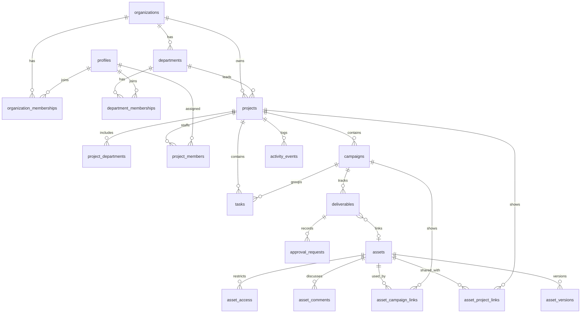

# Company Hub — Backend architecture and Supabase migration plan

Status: audit only. No tables, packages, or UI changes are part of this document.

Company Hub is a Next.js 16.4.5 App Router frontend. React 19, TypeScript, Tailwind CSS 4, and shadcn/ui (Base UI) render a single company, Northline. There is no Supabase project, no `middleware.ts`, no `.env` file, and no authentication package. Identity, roles, and approval rights are constants and React state in the browser.

This plan describes the current app, a normalized PostgreSQL schema, server-enforced permissions, private storage, and an incremental migration that leaves the demo working until each slice is switched.

## 1. Current architecture

### Routes and pages

All pages sit under `src/app` and share `WorkspaceProvider` plus `AppShell` from the root layout.

| Route | Role today |
| --- | --- |
| `/` | Company dashboard: KPIs, tasks, projects, activity |
| `/projects` | Project list |
| `/projects/[id]` | Project detail. Tabs: Overview, Campaigns, Tasks, Files & Assets, Team, Activity |
| `/tasks` | My Tasks, filtered to the simulated current user |
| `/activity` | Company activity feed |
| `/assets` | Assets library: search, filters, sort, grid/list, create |
| `/assets/[id]` | Asset detail: metadata, comments, versions, linked deliverables |
| `/artifacts` | Static Artifact Hub |
| `/knowledge` | Static knowledge articles |
| `/workspaces/marketing` | Marketing workspace: campaign KPIs, search, filters, create |
| `/workspaces/marketing/campaigns/[id]` | Campaign detail. Tabs: Overview, Tasks, Deliverables, Assets, Activity |
| `/people` | Static team directory |
| `/settings` | Static preview profile. Copy already says sign-in comes later |

Dynamic routes prebuild known mock ids with `generateStaticParams`. A record created in the browser still renders through the client store, but its document title stays on the seed fallback until that id exists at build time.

Navigation is a closed set of static paths in `src/components/layout/navigation.ts`. Project, campaign, and asset links are separate string types (`ProjectHref`, `CampaignHref`, `AssetHref`). Only Marketing exists as a department workspace. Design, Product, People, and Engineering appear as tags on projects, not as routes.

### Reusable UI

- Shell: `src/components/layout/` — sidebar, header, breadcrumbs, search, notifications, quick-create project dialog.
- State: `src/components/workspace/workspace-provider.tsx` is the only client store. Pages and feature views call `useWorkspace()`.
- Projects: `src/components/projects/` — detail tabs, edit dialog, shared `ProjectCard`.
- Marketing: `src/components/marketing/` — workspace, campaign detail, campaign/task/deliverable dialogs, “Acting as” switcher.
- Assets: `src/components/assets/` — library, detail, form dialog, type icon/preview.
- Dashboard, tasks, and activity views read the same store.
- `src/components/ui/` is shadcn/ui. Do not replace it during the backend migration.
- `src/lib/presentation.ts` maps statuses to classes. `src/lib/project-records.ts` derives project files, campaign lists, and activity slices. `src/lib/dates.ts` formats stored date strings without calling `Date` during render.

### TypeScript models

`src/lib/types.ts` is the shared contract. The shapes that must survive the migration:

- `Project` — lead `department`, collaborating `departments[]`, `ownerId`, `memberIds`, and `team[]` of `{ memberId, projectRole }`. `progress` is a stored number. Dates are display strings (`startLabel`, `deadlineLabel`), not ISO dates.
- `Campaign` — belongs to one `projectId`. ISO `startDate` / `endDate`. Progress is not stored; `campaignProgress()` derives it from tasks marked Done and deliverables marked Approved.
- `Task` — `projectId`, optional `campaignId`, assignee, priority, status, display `dueLabel`, optional ISO `dueDate`.
- `Deliverable` — `campaignId`, denormalized `projectId`, `creatorId`, status, optional `assetId`.
- `Asset` — one optional `projectId` and one optional `campaignId`. `type` is the canonical type. `kind` is a second, older label used to group files. `url` and `href` are the same external link. `visibility` is `Company | Project Members | Restricted`. `collection` is a free-text folder name.
- `AssetComment`, `AssetVersion` — metadata only. Versions do not point at a file.
- `ActivityItem` — actor, summary text, a client route `href`, optional project and campaign ids.
- `NotificationItem` — separate from activity, with a `read` flag.
- `TeamMember` — id, name, job title, department, email, avatar color. Not an auth user.
- `Artifact`, `Article`, `Milestone` — static content, not in the records store.

### Mock data

| File | Contents | Where it is read |
| --- | --- | --- |
| `src/lib/mock-data/projects.ts` | 6 projects (`spring`, `brand`, `harbor`, `demand`, `onboarding`, `webinar`) | React state, reset on refresh |
| `src/lib/mock-data/team.ts` | 7 people. `currentUserId` and `marketingManagerId` are both `"maya"` | Direct imports |
| `src/lib/mock-data/campaigns.ts` | 4 campaigns | Seed for the records store |
| `src/lib/mock-data/tasks.ts` | Tasks, some with `campaignId` | Records store |
| `src/lib/mock-data/deliverables.ts` | Deliverables. `del-onepager` links `asset-onepager`. `del-film` links `asset-interview` | Records store |
| `src/lib/mock-data/assets.ts` | 9 assets, comments, versions | Records store |
| `src/lib/mock-data/activity.ts` | Activity feed. `initialNotifications` is the same array | Activity is stored; notifications are copied into React state |
| `src/lib/mock-data/library.ts` | 5 artifacts, knowledge articles | Static pages and the project files tab |
| `src/lib/mock-data/milestones.ts` | Project milestones | Project overview only |

Stable ids matter. Deliverables and links already point at `asset-onepager`, `asset-interview`, and `asset-matrix`. Routes use `spring`, `campaign-harbor`, and `asset-wordmark`.

### State and localStorage

`src/lib/records-store.ts` is a `useSyncExternalStore` module.

- Key: `company-hub.records.v1`.
- Persisted: campaigns, tasks, deliverables, activity, assets, asset comments, asset versions.
- Server snapshot: a constant JSON string of the seed. The first client render matches the server, then the snapshot switches to localStorage. That avoids hydration mismatches.
- Writes happen in `updateRecords`, which is only called from event handlers. `getSnapshot` does not write storage.
- If campaigns, tasks, deliverables, or activity fail validation, the whole seed is restored. If those are valid but asset arrays are missing, only the asset arrays are filled from the seed. User campaigns survive an assets upgrade.
- Empty arrays are valid and are kept.

Not persisted:

- Projects and project edits.
- Notifications and read state.
- The “Acting as” user (`actorId`, `useState(currentUserId)`).
- The last-created project banner.

`crypto.randomUUID()` and `new Date()` run inside click handlers only. Ids look like `campaign-`, `task-`, `del-`, `act-`, `notice-`, `asset-`, `comment-`, `version-`, plus a UUID.

### Relationships as implemented

```text
Organization (implicit: Northline)
  └── TeamMember (static)
  └── Project
        ├── lead department + collaborating departments
        ├── team assignments (free-text projectRole)
        ├── Campaign (many, one project each)
        │     ├── Task (optional campaignId, always a projectId)
        │     └── Deliverable (campaignId + copied projectId, optional assetId)
        ├── Task (project tasks that may omit a campaign)
        ├── Asset (at most one projectId and one campaignId)
        │     ├── AssetComment
        │     └── AssetVersion
        └── Artifact (static, separate from assets)
ActivityItem → actor + optional project + optional campaign + a URL
NotificationItem → a URL, not a foreign key
```

One project record is shared by the dashboard, project list, project detail, and Marketing. Marketing does not own a second copy of projects. Campaigns reference `projectId`.

Assets are one record with one id. The library, project Files & Assets tab, campaign Assets tab, and deliverable picker all read `records.assets`. Archived assets drop out of project and campaign lists and stay available by id.

The current asset foreign keys are narrower than the product needs:

- An asset can name only one project and one campaign.
- `asset-color` is on project `brand` and campaign `campaign-launch` (project `spring`). The campaign link and the project link already disagree. A link table is required so one asset can attach to many projects and campaigns without cloning the row.
- `kind` duplicates `type` and is only there so older file groups keep working.

Deliverable approval is not a table. `setDeliverableStatus` mutates `deliverables.status`:

- The creator may move Draft or Changes Requested to In Progress, and Draft, In Progress, or Changes Requested to Submitted.
- Approve and Changes Requested are allowed only when the status is Submitted and `actorId === marketingManagerId`.
- That function lives in client code (`canReviewDeliverable`). The “Acting as” control can switch `actorId` to Maya or to anyone else. Nothing on a server checks it.

Project `progress` is edited by hand. Campaign progress is computed. Those two numbers will drift if both are stored.

### Authentication and authorization assumptions

There is no session, password, or organization membership.

- The signed-in user is the constant Maya Chen (`maya`).
- Marketing Manager is the same constant, not a role that can be granted.
- `workspaceRole()` returns “Marketing Manager” or “Contributor”. It is a label for the switcher.
- Project roles are display strings: Owner, Design, Marketing, Content, and similar. They do not grant or deny actions.
- Asset visibility is a badge. `visibilityNote` states that the labels do not restrict access.
- Settings describes the current profile as a preview.

Anyone who can open the app, or edit localStorage, can change any persisted record and can mark a deliverable approved by acting as Maya.

## 2. Database design

PostgreSQL on Supabase. Every tenant table carries `organization_id`. Northline is the first row, not a hard-coded special case in queries.

Use `uuid` primary keys with `gen_random_uuid()`. Keep the current demo ids in `slug text` so `/projects/spring` and `/assets/asset-onepager` keep resolving during the migration. Slugs are unique per organization.

Timestamps are `timestamptz`. Store calendar dates as `date`. Stop writing new display strings such as “Updated yesterday”; format those in the client from `updated_at`.

### organizations

The tenant boundary.

| Column | Notes |
| --- | --- |
| `id uuid` pk | |
| `name text` not null | Northline |
| `slug text` unique not null | `northline` |
| `created_at timestamptz` | default `now()` |

Delete: restricting. Deleting an organization is an operator action. Child rows use `on delete cascade` from this id so a removed tenant does not leave orphans. Application code does not expose organization delete.

### departments

| Column | Notes |
| --- | --- |
| `id uuid` pk | |
| `organization_id uuid` not null | fk `organizations`, cascade |
| `name text` not null | Marketing, Design, Product, People, Engineering |
| `slug text` not null | |
| unique `(organization_id, slug)` | |

Delete: restrict from projects and memberships, or block delete while referenced. Seed the five current departments. Do not treat the department name as a permission.

### profiles

One row per Supabase Auth user. `id` equals `auth.users.id`.

| Column | Notes |
| --- | --- |
| `id uuid` pk | fk `auth.users`, cascade |
| `full_name text` not null | |
| `email text` not null | copy of the auth email, updated by trigger |
| `job_title text` | current `TeamMember.role` (“Marketing lead”) |
| `avatar_color text` | display only |
| `initials text` | |
| `created_at`, `updated_at` | |

A profile has no organization role column. Roles live on memberships so one person can belong to more than one organization later.

Delete: deleting the auth user cascades the profile. FKs from content use `on delete restrict` for owners and `on delete set null` for actors where history should remain. Do not cascade-delete projects when a person is removed.

### organization_memberships

| Column | Notes |
| --- | --- |
| `id uuid` pk | |
| `organization_id uuid` not null | fk cascade |
| `profile_id uuid` not null | fk `profiles` cascade |
| `role org_role` not null | `org_admin`, `member`, `viewer` |
| unique `(organization_id, profile_id)` | |
| index `(profile_id)` | used by every RLS check |

`org_admin` manages people, departments, and org settings. `member` has no implicit access to private projects. `viewer` can read what membership otherwise allows, and cannot mutate.

Department Manager is not an organization-wide role. It is scoped in `department_memberships`. A Marketing Manager is a manager of the Marketing department, plus an explicit project permission where they approve work.

### department_memberships

| Column | Notes |
| --- | --- |
| `organization_id uuid` not null | |
| `department_id uuid` not null | fk restrict |
| `profile_id uuid` not null | fk cascade |
| `role department_role` not null | `manager` or `member` |
| primary key `(department_id, profile_id)` | |

A department manager can see that department’s workspace and is a candidate approver for deliverables on projects that include the department. They do not bypass project privacy. Project membership, or an explicit approver grant, is still required. See section 3.

### projects

Shared company projects. Marketing must not get a parallel project table.

| Column | Notes |
| --- | --- |
| `id uuid` pk | |
| `organization_id uuid` not null | fk cascade |
| `slug text` not null | current id (`spring`) |
| `name text` not null | |
| `description text` not null default `''` | |
| `lead_department_id uuid` not null | fk `departments` restrict |
| `status project_status` not null | `planning`, `in_progress`, `in_review`, `on_hold` |
| `owner_id uuid` not null | fk `profiles` restrict |
| `starts_on date` | null when “Not set” |
| `due_on date` | |
| `created_at`, `updated_at` | |
| unique `(organization_id, slug)` | |
| index `(organization_id, status)` | |
| index `(owner_id)` | |

Do not store `progress`. The UI can keep showing a number, computed from the same rule as campaigns or from completed milestones, once those are server data. The hand-edited `progress` field is a demo affordance and will be wrong as soon as tasks change underneath it.

`memberIds` and `team` move to `project_members`. Collaborating departments move to `project_departments`. The lead department is also inserted there so one query returns every department on the project.

Delete: `on delete cascade` to memberships, department links, campaigns, tasks, deliverables, approval requests, asset links, and activity rows for that project. Assets themselves stay. Storage objects stay until the asset is deleted.

### project_departments

| Column | Notes |
| --- | --- |
| `project_id uuid` | fk cascade |
| `department_id uuid` | fk restrict |
| `organization_id uuid` not null | denormalized for RLS, must match the project |
| primary key `(project_id, department_id)` | |

### project_members

| Column | Notes |
| --- | --- |
| `id uuid` pk | |
| `organization_id uuid` not null | |
| `project_id uuid` not null | fk cascade |
| `profile_id uuid` not null | fk cascade |
| `role project_role` not null | `project_manager`, `project_member`, `viewer` |
| `can_edit` boolean not null default false | |
| `can_manage_members` boolean not null default false | |
| `can_approve_deliverables` boolean not null default false | |
| `can_manage_assets` boolean not null default false | |
| `can_comment` boolean not null default true | |
| unique `(project_id, profile_id)` | |
| index `(profile_id, project_id)` | |

Map the current “Owner” assignment to `project_manager` with edit, members, assets, and comment enabled. Map other current team rows to `project_member`. Grant `can_approve_deliverables` to Maya on projects whose departments include Marketing, which matches today’s behavior without hard-coding her user id.

The boolean columns are the custom project permissions. They are small, typed, and easy to check in RLS. A `jsonb` bag is worse here: policies cannot see a new key unless someone updates every policy.

The owner is both `projects.owner_id` and a `project_manager` row. A check constraint or trigger keeps the owner present in `project_members`.

Delete: membership delete removes access immediately. It does not delete the person’s work. Reassign `owner_id` before removing the owner’s membership.

### campaigns

| Column | Notes |
| --- | --- |
| `id uuid` pk | |
| `organization_id uuid` not null | |
| `project_id uuid` not null | fk `projects` cascade |
| `slug text` not null | `campaign-launch` |
| `name`, `description`, `goals` | |
| `owner_id uuid` not null | fk profiles restrict |
| `type campaign_type` | `social_media`, `email`, `paid_ads`, `content`, `event`, `other` |
| `status campaign_status` | `planning`, `active`, `on_hold`, `completed` |
| `starts_on date` not null | |
| `ends_on date` not null | check `ends_on >= starts_on` |
| unique `(organization_id, slug)` | |
| index `(project_id, status)` | |

Progress stays derived. Deleting a campaign cascades its tasks (where `campaign_id` is set — tasks are children of the project, so campaign delete should `set null` on `tasks.campaign_id` rather than delete project tasks) and cascades deliverables that belong to the campaign.

Recommended task rule: `on delete set null` for `tasks.campaign_id`. Deliverables have no meaning without a campaign, so `deliverables.campaign_id` cascades.

### tasks

| Column | Notes |
| --- | --- |
| `id uuid` pk | |
| `organization_id uuid` not null | |
| `project_id uuid` not null | fk cascade |
| `campaign_id uuid` | fk set null |
| `title text` not null | |
| `description text` not null default `''` | |
| `assignee_id uuid` | fk profiles set null |
| `priority task_priority` | `low`, `medium`, `high`, `urgent` |
| `status task_status` | `todo`, `in_progress`, `in_review`, `done` |
| `due_on date` | |
| index `(assignee_id, status)` | My Tasks |
| index `(project_id)` | |
| index `(campaign_id)` | |

### deliverables

| Column | Notes |
| --- | --- |
| `id uuid` pk | |
| `organization_id uuid` not null | |
| `project_id uuid` not null | fk cascade |
| `campaign_id uuid` not null | fk cascade |
| `title text` not null | |
| `type deliverable_type` | `design`, `video`, `copy`, `document`, `presentation`, `other` |
| `creator_id uuid` not null | fk restrict |
| `status deliverable_status` | `draft`, `in_progress`, `submitted`, `changes_requested`, `approved` |
| `due_on date` | |
| `asset_id uuid` | fk `assets` set null. One current link, same as the UI |
| index `(campaign_id, status)` | |
| index `(creator_id)` | |

`project_id` is denormalized so RLS and project screens do not join through campaigns for every row. A trigger sets it from the campaign and rejects a mismatched project.

Clients do not update `status` directly. Status changes go through the functions in section 3, which also write `approval_requests`.

### approval_requests

The audit trail the UI does not have yet. The deliverable status remains what the screens read.

| Column | Notes |
| --- | --- |
| `id uuid` pk | |
| `organization_id uuid` not null | |
| `deliverable_id uuid` not null | fk cascade |
| `project_id uuid` not null | copied for RLS |
| `action approval_action` | `submit`, `start`, `approve`, `request_changes` |
| `from_status deliverable_status` not null | |
| `to_status deliverable_status` not null | |
| `actor_id uuid` not null | fk profiles restrict. Always `auth.uid()`, never a client-supplied user |
| `note text` | |
| `created_at timestamptz` not null | |

No update and no delete for normal roles. Approvals are append-only. An org admin delete of the deliverable cascades the history with it.

### assets

One row per creative item, never copied per project.

| Column | Notes |
| --- | --- |
| `id uuid` pk | |
| `organization_id uuid` not null | |
| `slug text` not null | `asset-onepager` |
| `name text` not null | |
| `description text` not null default `''` | |
| `type asset_type` | `image`, `video`, `document`, `presentation`, `design`, `external_link`, `other` |
| `external_url text` | required when type is `external_link`, check `http` or `https` |
| `tags text[]` not null default `'{}'` | |
| `owner_id uuid` not null | fk restrict |
| `visibility asset_visibility` | `company`, `project_members`, `restricted` |
| `collection text` not null default `'General'` | current free-text folders |
| `archived_at timestamptz` | null means active |
| `created_at`, `updated_at` | |
| unique `(organization_id, slug)` | |
| index `(organization_id, type)` | |
| index `(owner_id)` | |
| gin index on `tags` | search |
| index on `to_tsvector` name + description | search |

Drop `kind`, `href` as a second URL, and `updatedLabel`. File grouping uses `type`.

`restricted` means: owner, org admins, and profiles listed in `asset_access`. It does not mean “anyone who knows the URL”.

### asset_access

Needed for Restricted. Not in the original table list, and required to make that visibility real.

| Column | Notes |
| --- | --- |
| `asset_id uuid` | fk cascade |
| `profile_id uuid` | fk cascade |
| primary key `(asset_id, profile_id)` | |

### asset_project_links

| Column | Notes |
| --- | --- |
| `asset_id uuid` | fk cascade |
| `project_id uuid` | fk cascade |
| `organization_id uuid` not null | |
| `linked_by uuid` | fk set null |
| `created_at` | |
| primary key `(asset_id, project_id)` | |

Replaces `assets.project_id`. The Harbor stills asset and the color board can each link to the projects that actually use them.

### asset_campaign_links

| Column | Notes |
| --- | --- |
| `asset_id uuid` | fk cascade |
| `campaign_id uuid` | fk cascade |
| `organization_id uuid` not null | |
| `linked_by uuid` | |
| primary key `(asset_id, campaign_id)` | |

A campaign link does not imply a duplicate asset. The project files query reads `asset_project_links`. The campaign Assets tab reads `asset_campaign_links` plus deliverable `asset_id`s, which is what the UI already does.

### asset_versions

Metadata plus a pointer to storage. No bytea.

| Column | Notes |
| --- | --- |
| `id uuid` pk | |
| `organization_id uuid` not null | |
| `asset_id uuid` not null | fk cascade |
| `number integer` not null | check `number > 0` |
| `label text` not null | |
| `notes text` not null default `''` | |
| `author_id uuid` not null | fk restrict |
| `storage_bucket text` | null for external-link-only versions |
| `storage_path text` | null when there is no object |
| `mime_type text` | |
| `byte_size bigint` | check `>= 0` |
| `created_at timestamptz` not null | |
| unique `(asset_id, number)` | |

Current demo versions migrate with null storage fields and their existing labels.

### asset_comments

| Column | Notes |
| --- | --- |
| `id uuid` pk | |
| `organization_id uuid` not null | |
| `asset_id uuid` not null | fk cascade |
| `author_id uuid` not null | fk restrict |
| `body text` not null | check `char_length(trim(body)) > 0` |
| `resolved_at timestamptz` | null means open |
| `resolved_by uuid` | fk set null |
| `created_at timestamptz` not null | |
| index `(asset_id, created_at desc)` | |

### activity_events

| Column | Notes |
| --- | --- |
| `id uuid` pk | |
| `organization_id uuid` not null | |
| `actor_id uuid` | fk set null |
| `verb text` not null | `created`, `updated`, `submitted`, `approved`, `commented` |
| `summary text` not null | current sentence, until the client composes it from verb + target |
| `project_id uuid` | fk cascade |
| `campaign_id uuid` | fk set null |
| `task_id uuid` | fk set null |
| `deliverable_id uuid` | fk set null |
| `asset_id uuid` | fk set null |
| `created_at timestamptz` not null | |
| index `(organization_id, created_at desc)` | |
| index `(project_id, created_at desc)` | |

Replace the stored `href`. The client builds `/projects/{slug}`, `/workspaces/marketing/campaigns/{slug}`, or `/assets/{slug}` from the linked row. A stored URL will rot when slugs change and can point at another tenant.

### notifications

The app already has notifications, separate from the feed. Phase 8 needs this table even though it was not in the first entity list.

| Column | Notes |
| --- | --- |
| `id uuid` pk | |
| `organization_id uuid` not null | |
| `recipient_id uuid` not null | fk cascade. One row per recipient |
| `activity_event_id uuid` | fk set null |
| `title text` not null | |
| `read_at timestamptz` | |
| `created_at` | |
| index `(recipient_id, read_at, created_at desc)` | |

Inserts come from database triggers or server actions after a real event. The client does not invent notifications for other users.

### Deferred content

Artifacts, knowledge articles, and milestones are static modules. Leave them in the frontend until a later content phase. Do not fold artifacts into `assets` during the first migration; the project files view would start hiding or duplicating them. When they move, artifacts become assets (or a `kind = reference` record) and articles become an `articles` table with org RLS.

### Entity relationships



### Indexes and write rules

- Index every foreign key that a list screen filters on. The unique constraints above already cover the link tables.
- Add a partial index `assets (organization_id, updated_at desc) where archived_at is null` for the library.
- Enable Row Level Security on every table in this section before any grant to `authenticated`.
- `service_role` bypasses RLS. It is only used from trusted server jobs (seed, migration), never from the browser.
- Updated-at triggers maintain `updated_at` on projects, campaigns, tasks, deliverables, and assets.

## 3. Authentication and permissions

### Supabase Auth

- Email and password, or the company’s SSO later, through Supabase Auth. The first milestone can be email magic link or password for the seven seeded people.
- A trigger on `auth.users` inserts `profiles`.
- Invite flow: an org admin creates `organization_memberships` for an email. Until the person accepts, there is no session and no RLS access.
- The app reads the user from the server (`getUser()`), not from a local `currentUserId`.
- Remove the “Acting as” control when auth ships. It is a demo impersonation switch. Leaving it in a Supabase build would let the browser claim to be the approver while the database still uses the real user — or, worse, a client would send `actor_id` and the database would trust it. Functions must use `auth.uid()` only.

### Role meanings

| Role | Where it lives | What it allows |
| --- | --- | --- |
| Organization Admin | `organization_memberships.role = org_admin` | People, departments, all projects in the org, settings. Can approve any deliverable in the org. |
| Department Manager | `department_memberships.role = manager` | That department’s workspace. Approves deliverables only on projects that include the department and where this person is a project member or has `can_approve_deliverables`. |
| Project Manager | `project_members.role = project_manager` | Edit project, manage members, manage assets and tasks. Approve only if `can_approve_deliverables` is set. |
| Project Member | `project_members.role = project_member` | Read the project. Create and edit tasks and deliverables they are assigned or created. Comment if `can_comment`. |
| Viewer | org role `viewer`, or project role `viewer` | Read only. No inserts except none. |

Custom project permissions are the five booleans on `project_members`. Defaults:

- Project manager: edit, manage members, manage assets, comment. Approve is opt-in.
- Project member: comment. Other flags off.
- Viewer: all flags off, and writes are denied even if a flag is wrong.

A Marketing Manager is a Department Manager of Marketing who also has `can_approve_deliverables` on the marketing projects they review. Seed Maya that way. Priya stays a Marketing department member and a project member, without the approve flag, matching the current Contributor behavior.

### Server enforcement

Frontend checks may hide buttons. They are not the permission system. Every table enables RLS. Policies call `security definer` helpers in a private schema (`private.can_…`) so the policy stays short and the helper reads memberships without recursive RLS surprises. Helpers are `stable`, take explicit ids, and use `auth.uid()`.

```text
private.is_org_member(org)
private.is_org_admin(org)
private.is_department_manager(org, department)
private.project_role(project)  -- null when no row
private.project_flag(project, flag_name)
private.can_read_project(project)
private.can_read_asset(asset)
private.can_review_deliverable(deliverable)
```

`can_read_project`: org admin, or a `project_members` row of any role.

`can_read_asset`:

- Same organization, and
- `company`: any organization member, or
- `project_members`: a member of any linked project, or the owner, or
- `restricted`: owner, org admin, or `asset_access` row.

Campaign-only links do not grant read unless the person can read that campaign’s project.

Write policies:

- Insert project: org admin, or a department manager creating a project led by their department. The insert trigger adds the creator as project manager.
- Update project: org admin or `can_edit`.
- Insert campaign, task, deliverable: `can_edit` or project member. A member cannot change someone else’s task assignee to escalate work outside the project. Assignee must already be a project member (trigger).
- Deliverable status: no direct `update` grant on `status` for `authenticated`. Revoke column update or use a before-update trigger that rejects `status` changes from a normal session.

Transition functions, `security definer`, granted to `authenticated`:

| Function | Who | From → to |
| --- | --- | --- |
| `start_deliverable(id)` | creator, and can read the project | `draft` or `changes_requested` → `in_progress` |
| `submit_deliverable(id)` | creator | `draft`, `in_progress`, or `changes_requested` → `submitted` |
| `review_deliverable(id, decision, note)` | `can_review_deliverable` | `submitted` → `approved` or `changes_requested` |

`can_review_deliverable` is true when the caller is an org admin, or has `can_approve_deliverables` on that project, or is the Marketing department manager and the project includes Marketing and the caller can read the project. Each call inserts an `approval_requests` row and an `activity_events` row in the same transaction. A second review of an already approved deliverable fails.

Asset comments: insert when `can_read_asset` and (`can_comment` on a linked project, or org admin, or owner). Resolve: author, owner, project manager, or org admin.

Asset versions: insert metadata when `can_manage_assets` on a linked project, or the owner. The storage path is set by the upload function, not typed in by the client.

### What the client still does

The UI may call `can_approve_deliverables` from a server-provided capability object to hide Approve. If that object is stale, the button might show and the RPC will reject. The user sees an error. The row does not change.

## 4. Storage architecture

Bucket: `assets`, private, no public read.

Object key:

```text
{organization_id}/{asset_id}/v{number}/{filename}
```

`asset_versions.storage_bucket` and `storage_path` point at that object. External Link assets have no object. A version may be notes-only, which is what the demo stores today.

Access:

- `storage.objects` RLS allows `select` only when `private.can_read_asset(asset_id)` is true for the id embedded in the path. Parse the path in the policy; do not trust a client metadata flag.
- `insert` and `update` only when `can_manage_assets` for a project linked to that asset, or the caller is the owner, and the path organization matches their membership.
- There is no policy for `public` or for anonymous users.
- The browser never receives a permanent URL. A server action checks `can_read_asset`, then creates a signed URL with a short TTL (about two minutes) for display, or a signed upload URL for a single version path.
- Downloads of another organization’s object fail the RLS check even if the path is guessed.

Upload rules, enforced when issuing the signed upload and again in a storage trigger or edge check:

- Allowed types: images (`image/jpeg`, `image/png`, `image/webp`, `image/gif`), video (`video/mp4`, `video/webm`), documents (`application/pdf`, Office doc/docx), presentations (pdf or pptx), design exports (pdf, png, svg, zip). Reject the rest.
- Size caps by type (for example images 25 MB, documents 50 MB, video 500 MB). Reject oversized uploads.
- Filename is sanitized. The version number is allocated by `add_asset_version`, not chosen by the client, so a caller cannot overwrite `v1`.
- Do not store file bytes, base64, or signed URLs in Postgres or localStorage.
- Deleting an asset deletes its objects in the same server transaction as far as the Storage API allows, and always deletes the version rows via `on delete cascade`. A failed object delete is retried by a cleanup job keyed off versions whose asset is gone.

Project-based access is the link tables plus `can_read_asset`. Linking an asset to a project does not copy the file. Removing the last project link does not delete the file; visibility then falls back to company, restricted, or owner.

## 5. Migration strategy

Keep the current UI and the localStorage demo as the default until a slice has a server implementation and a flag turns it on. Do not big-bang replace `WorkspaceProvider`.

### Preservation rules

- Add a small data gateway that implements the methods `useWorkspace` already exposes: list and mutate projects, campaigns, tasks, deliverables, assets, comments, versions, activity, notifications.
- Default implementation is the current provider. A second implementation calls server actions.
- Flags are server-side (`DATA_PROJECTS`, `DATA_CAMPAIGNS`, and so on), read when rendering, not a secret. The publishable Supabase key may be public. The service role key must not use the `NEXT_PUBLIC_` prefix and must not ship to the client.
- While a flag is off, that slice keeps today’s render path, including the server snapshot and localStorage behavior.
- Seed Supabase from the existing mock modules so ids/slugs match. Demo screens look the same after the switch.
- Do not run a migration that deletes `company-hub.records.v1`. When a slice moves, read localStorage once, offer to import rows whose slug is absent on the server, then leave the key in place until the last slice has moved.
- Projects created only in memory still disappear on refresh until the projects flag is on. Call that out in the UI only when that phase starts; do not change copy in this audit.
- `generateStaticParams` can keep listing seed slugs. New records render on demand.

### Phase 1 — Supabase configuration

- Create the Supabase project and the private `assets` bucket.
- Add server-only environment variables. Confirm the service role is absent from client bundles.
- Add the SSR client for Next.js server components and server actions. No schema yet beyond a connectivity check.
- App behavior stays on mock data.

### Phase 2 — Authentication

- Enable Auth, profile trigger, and a sign-in screen that does not replace the shell.
- Seed the seven people as auth users and profiles, with Maya as org admin and Marketing department manager.
- Session required for new server routes. Until later flags flip, the existing demo can stay available behind a local development bypass that never ships to production.
- Remove any plan to pass `actorId` into the database.

### Phase 3 — Schema and RLS

- Create the tables, enums, helpers, and policies in section 2 and 3.
- Turn RLS on before granting `authenticated`.
- Seed Northline, departments, memberships, and project permissions from `team.ts` and `projects.ts`.
- Test with two users: Maya can review; Priya cannot approve. Test a second organization row that Maya cannot read.
- Still no UI switch.

### Phase 4 — Projects

- Server-read projects, members, and departments.
- Point the projects flag at the gateway. Dashboard cards, `/projects`, and `/projects/[id]` use it.
- Create and edit go through server actions. The in-memory project list stops being the source of truth for that flag.
- Milestones and artifacts stay local.

### Phase 5 — Campaigns

- Move campaigns. Creating a campaign writes `project_id` only; it does not copy the project.
- Marketing workspace and the project Campaigns tab share the query.
- Keep tasks and deliverables on localStorage for one beat so a half-migrated campaign still shows its old children, keyed by slug, until phase 6.

### Phase 6 — Tasks and deliverables

- Move tasks, deliverables, and approval functions together. Splitting them would let a client approve locally and then overwrite the server.
- Replace `setDeliverableStatus` with the three RPCs.
- My Tasks reads `assignee_id = auth.uid()`.
- Campaign progress remains a query, not a column.

### Phase 7 — Assets and storage

- Move assets, link rows, comments, and versions.
- Map the single `projectId` / `campaignId` into link rows. For `asset-color`, link project `brand` and campaign `campaign-launch` (and that campaign’s project if the product wants both projects).
- Upload writes a version row and a private object. External URLs stay on `external_url`.
- Library, project files, campaign assets, and the deliverable picker all select by asset id.

### Phase 8 — Activity and notifications

- Write `activity_events` inside the same transaction as the mutation (trigger or the RPC).
- Fan out `notifications` to project members who should see them. Recipient reads and marks read.
- Stop prepending client-only notification objects.
- Activity links are built from slugs, not stored paths.

After phase 8, delete the localStorage path only when production no longer reads it. Until then the mock gateway remains for tests and for offline UI work.

## 6. Security review

| Risk | What the repo does now | Required fix |
| --- | --- | --- |
| Exposed secrets | No `.env` and no service key in the repo. Low today. | Keep the service role on the server. Scan the client bundle after the SDK is added. Do not commit `.env`. |
| Missing RLS | There is no database. When tables exist, the Supabase Data API would expose them if RLS is off. | Enable RLS in the same migration as `create table`. Deny by default. |
| Cross-organization access | One implicit company. A later second tenant would be visible if queries forget `organization_id`. | `organization_id` on every row and inside every policy, not only in the app filter. |
| Unauthorized approvals | `canReviewDeliverable` compares `actorId` to the constant `maya`. The Acting as menu sets `actorId`. | `review_deliverable` uses `auth.uid()` and `can_approve_deliverables` or department-manager scope. No client user id. |
| Unsafe uploads | Uploads are intentionally not stored. A later public bucket, or base64 in Postgres/localStorage, would publish files. | Private bucket, signed URLs, mime and size checks, versioned paths. |
| Client-only permissions | Visibility labels, project roles, and Marketing Manager are UI. localStorage is editable. | Policies and RPCs. UI checks are optional. |
| Duplicate or split records | Projects are not in the same store as campaigns. An asset has a single project and a single campaign, and one seed asset already points across them. `project_id` on deliverables can drift from the campaign. Notifications are a copy of the activity array plus session-only items. | One project table, link tables for assets, trigger to sync deliverable `project_id`, notifications generated from events. |
| Stored routes in activity | `href` can target any path the client picks. | Store entity ids. Render paths from slugs. |
| Predictable demo auth | The preview user is hard-coded and documented in the People page. | Real sessions before any production data. |

## 7. Security checklist

- [ ] RLS enabled on every public table, including link tables and `approval_requests`.
- [ ] `authenticated` grants are limited to the policies. No table is granted `all`.
- [ ] Service role is server-only and absent from `NEXT_PUBLIC_*`.
- [ ] Policies use `auth.uid()` helpers, not a user id from the request body.
- [ ] A user in org A cannot `select` org B by guessing a uuid.
- [ ] Priya can submit her deliverable and cannot approve it.
- [ ] Maya can approve a submitted deliverable on a Marketing project where the flag is set, and cannot approve a project that excludes her.
- [ ] Direct `update deliverables set status = 'approved'` from the client session fails.
- [ ] Each approval inserts one `approval_requests` row with the real actor.
- [ ] Asset `restricted` is invisible to a project member who is not on `asset_access`.
- [ ] Storage `select` fails for a user who fails `can_read_asset`, including with a crafted path.
- [ ] Signed URLs expire. They are not written into the database.
- [ ] Upload rejects a disallowed mime type and an oversized file.
- [ ] External URLs accept only `http` and `https`.
- [ ] Assignee and asset owner must belong to the same organization.
- [ ] Deleting a project removes links and child work, not the asset row or other projects’ links.
- [ ] Activity and notifications cannot be inserted by a user for an arbitrary actor or recipient, except through the owning transaction.

## 8. Open decisions

1. **Single organization in production, or multi-tenant from the first migration?** The schema is multi-tenant. The product can still ship one organization. Confirm before writing policies that assume a single org.
2. **Project progress.** Recommend computing it and retiring the editable percentage. If stakeholders want the manual number, store it as `manual_progress` and label it as manual so it is not confused with campaign progress.
3. **Marketing approval scope.** Recommend the project flag `can_approve_deliverables`, granted to the Marketing department manager on projects that include Marketing. The alternative is “any Marketing department manager can approve any Marketing-linked project without a membership.” That is broader than the current team lists and should be an explicit product choice.
4. **Viewer at org level vs project level.** Both exist in the model. Decide whether an org viewer sees every company-visible asset or only projects they are invited to. Recommendation: invited projects only, plus company-visible assets.
5. **Asset collections.** Keep the text column for the first migration. A real folder tree can wait until users nest collections.
6. **Color board links.** Confirm whether `asset-color` should link to the brand project, the launch campaign, and the spring project, or only the two relations stored today.
7. **Tasks when a campaign is deleted.** Recommendation: keep the task on the project and null the campaign. Confirm that Marketing does not expect those tasks to disappear.
8. **Identity provider.** Email auth is enough to build RLS. SSO can wait. Decide who may invite members: org admins only, recommended.
9. **Artifacts, articles, milestones.** Leave them in the client until after phase 8, unless project files must show artifacts from the database on day one.
10. **Realtime.** Notifications can poll or use Supabase Realtime later. Do not block the schema on Realtime.

## 9. What this phase does not do

No Supabase tables, no new packages, no replacement of localStorage, and no UI or behavior changes. The next implementation step is phase 1 configuration, still behind the mock gateway.
